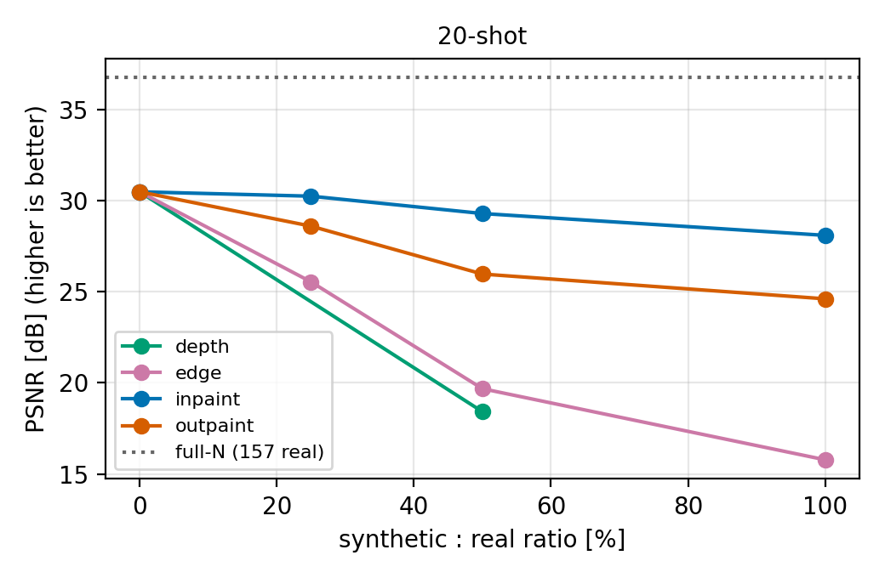
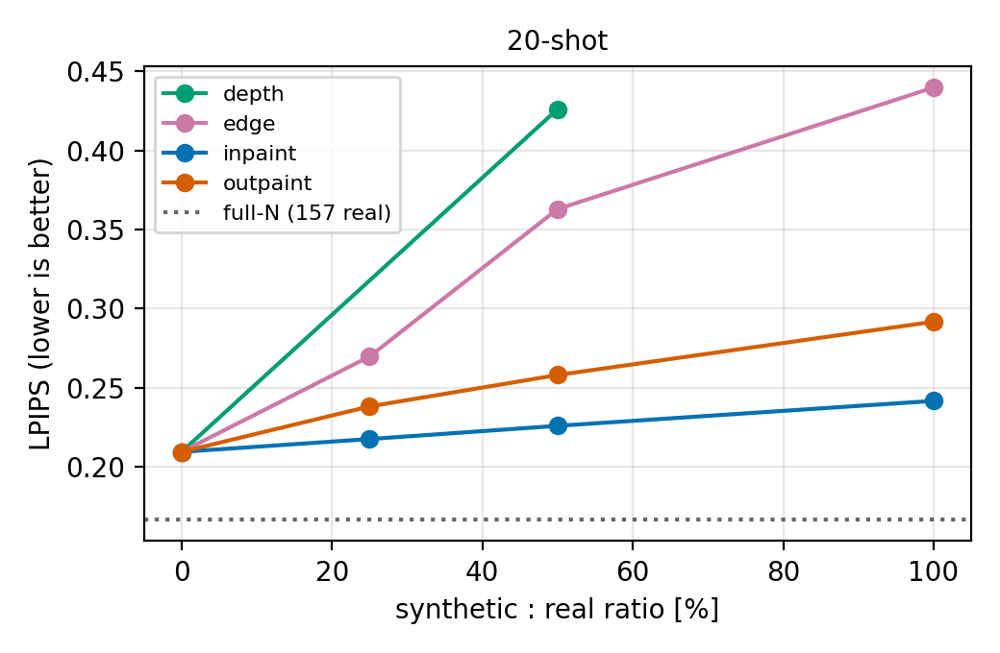
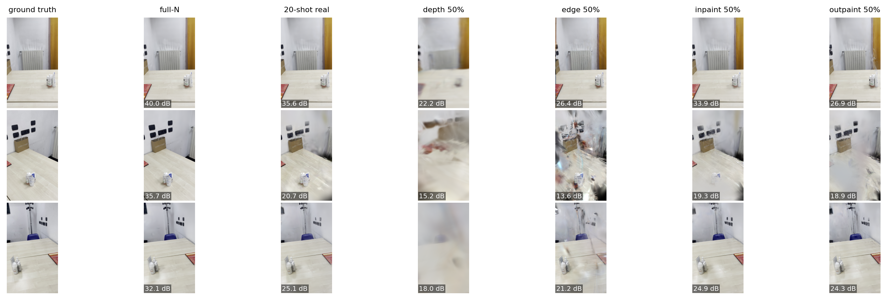
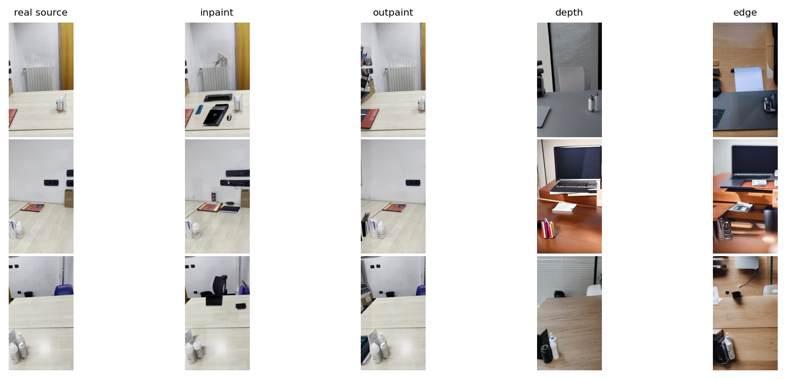

# Few-Shot Gaussian Splatting with Diffusion-Based Data Augmentation

Course project, *Virtual Reality for Robotics* (104737), University of Genoa, a.y. 2025/26.

Question: can synthetic views generated by diffusion models **only from a few real images** help (or hurt) 3D Gaussian Splatting (GS) trained in a few-shot setting? Four diffusion strategies are compared at several synthetic:real ratios against a full-N baseline and a real-only few-shot baseline, on identical held-out real views.

> **Status:** complete for the 20-shot setting (14 conditions, free Colab T4). See [Findings](#findings). The 5- and 10-shot sets are implemented (`fewshot_names`) but were not run.

## Credits and what is original

The overall pipeline idea (SfM reference map -> localize synthetic frames with HLoc -> GS experiments) and part of the code structure are adapted from
[mxhrnxz/Few_Shot_Gaussian_Splatting_with_Diffusion_Based_Data_Augmentation](https://github.com/mxhrnxz/Few_Shot_Gaussian_Splatting_with_Diffusion_Based_Data_Augmentation),
which used web video generators (PixVerse, Kling, Pika, Runway) on 20 real images.

| | Original project | This project |
|---|---|---|
| Data | their video | own video (82 s), 180 frames |
| Baselines | few-shot real only | **full-N** (>=100 real) + few-shot real only |
| Few-shot sizes | 20 | 20 run (5 / 10 nested subsets implemented, not run) |
| Ablation axis | 4 web video models | **4 diffusion strategies**, open models: inpainting, outpainting, depth-guided, edge-guided |
| Ratios | 25-200% | 0, 25, 50, 100% |
| Reference-map script | missing from repo | written (`02_build_real_map.py`) |
| Test split | `--eval` in stock GS ignores `test.txt` (see below) | patched + asserted |
| Point-cloud init | full map copied into every scene | only points seen by >= 2 selected real training images |
| Outputs | metrics table | + plots, side-by-side panels, localization statistics |

**Two protocol issues of the original code that are fixed here.**
Stock graphdeco `readColmapSceneInfo(..., llffhold=8)` never reads `sparse/0/test.txt`; it holds out every 8th image by sorted name, which can put synthetic images in the test set. `05_run_gs_experiments.py` patches it (`llffhold=0`) and aborts if the number of rendered test views differs from `test.txt`. Also, copying the full map's 3D points into few-shot scenes leaks geometry from frames outside the few-shot set; here `--init-points visible` is the default (`full` reproduces the original behaviour).

## Experimental design

* Full set: 180 real frames (blurriest 10% dropped). A contiguous middle block (60 frames) is removed from the incomplete set (`gap.json`).
* Held-out test (23 views, the same for **every** condition): 15 views = every 8th registered frame outside the gap (close to training frames) + 8 views = every 8th frame *inside* the removed gap (never seen by any condition, not even full-N). Metrics are reported overall and split near-train / in-gap (`*_out`, `*_gap` in the CSV).
* Few-shot sets: 5 ⊂ 10 ⊂ 20 frames spread evenly over the remaining pool (105 frames).
* Synthetic images are generated only from the 20-shot real frames, localized in the full real map (HLoc: NetVLAD + SuperPoint + SuperGlue), and added to the **training side only**. `S = round(N * ratio)`.
* Metrics: PSNR, SSIM, LPIPS; training time; peak GPU memory.
* Strategies (Stable Diffusion 1.5, fp16): `inpaint` (random regions repainted), `outpaint` (panned frame, revealed strip painted), `depth` (ControlNet-depth, Depth-Anything-V2), `edge` (ControlNet-canny). Depth/edge use a small pan of the control image to approximate a nearby viewpoint.

## Repository layout

```
src/common.py               split, nested few-shot sampling, synthetic selection helpers
scripts/01_extract_frames.py        video -> frames, blur filter, gap, boundary frames (laptop, ffmpeg)
scripts/02_build_real_map.py        HLoc/COLMAP reference map on the full set          (GPU)
scripts/03_generate_synthetic.py    4 diffusion strategies from the few-shot real set  (GPU)
scripts/04_inject_synthetic.py      localize synthetic images, per-image inliers, GS-ready scene (GPU)
scripts/05_run_gs_experiments.py    all conditions: train, render, metrics, time, memory (GPU)
scripts/06_make_panels_and_plots.py plots, results table, side-by-side panels
notebooks/colab_pipeline.ipynb      end-to-end run on Colab (T4)
report/                             LaTeX report + refs.bib
```

## Reproducing

1. **Laptop** (ffmpeg only, optional `pip install numpy pillow`):
   `python scripts/01_extract_frames.py --video IMG_0711.MOV --out data/outputs`
2. Upload `data/outputs/` to Google Drive (`MyDrive/fewshot_gs/outputs`) and open `notebooks/colab_pipeline.ipynb` on a **T4 GPU** runtime. Set the scene prompt in step 03.
3. Run the notebook cells in order (steps 02 -> 06). Step 05 is resumable (`results.jsonl`); start with `--only full few20_real --iterations 3000` as a smoke test. Conditions whose training crashes (e.g. diverged runs) are logged to `gs_runs/failures.jsonl` and skipped.
4. Copy `data/outputs/results/` next to the report and fill in the LaTeX tables.

Default budget: half resolution (`-r 2`), 15k iterations; adjust `--iterations/--resolution` to fit free-tier limits. Record the GS commit printed by the notebook for exact reproducibility.

Requirements: see `requirements.txt` (plus HLoc, pycolmap and graphdeco gaussian-splatting, installed in the notebook).

## Findings

20-shot setting, 23 held-out real views (15 near training frames, 8 inside the removed block), 15k iterations, half resolution, one run per condition.

| condition | train img. | time [min] | mem [MB] | PSNR | SSIM | LPIPS | PSNR near / gap |
|---|---|---|---|---|---|---|---|
| full-N | 157 | 19.0 | 5001 | **36.74** | **0.969** | **0.167** | 37.36 / 35.59 |
| 20-shot real only | 20 | 17.0 | 3941 | 30.47 | 0.936 | 0.209 | 34.61 / 22.73 |
| inpaint 25% | 25 | 16.4 | 3337 | 30.23 | 0.934 | 0.217 | 34.22 / 22.75 |
| inpaint 50% | 30 | 16.1 | 3433 | 29.28 | 0.930 | 0.226 | 33.22 / 21.90 |
| inpaint 100% | 40 | 16.1 | 3361 | 28.09 | 0.926 | 0.242 | 31.74 / 21.23 |
| outpaint 25% | 25 | 17.1 | 3375 | 28.59 | 0.922 | 0.238 | 32.15 / 21.91 |
| outpaint 50% | 30 | 17.3 | 3873 | 25.96 | 0.913 | 0.258 | 28.71 / 20.82 |
| outpaint 100% | 40 | 17.2 | 3783 | 24.61 | 0.895 | 0.292 | 27.72 / 18.77 |
| depth 25% | 25 | - | - | diverged (out of GPU memory) | | | |
| depth 50% | 30 | 36.9 | 9083 | 18.42 | 0.849 | 0.426 | 20.08 / 15.31 |
| depth 100% | 40 | - | - | diverged (out of GPU memory) | | | |
| edge 25% | 25 | 17.5 | 2953 | 25.54 | 0.902 | 0.270 | 28.53 / 19.92 |
| edge 50% | 30 | 18.1 | 3259 | 19.68 | 0.817 | 0.363 | 22.65 / 14.11 |
| edge 100% | 40 | 16.5 | 2909 | 15.78 | 0.788 | 0.440 | 17.03 / 13.44 |

 





**What the numbers say**

* There is headroom: full-N is 6.3 dB above the 20-shot real baseline, and 12.9 dB above it on the in-gap views.
* **No diffusion strategy beat the real-only baseline.** The only near tie is inpainting at 25% (30.23 vs 30.47 dB; within what one run cannot separate from noise).
* PSNR falls monotonically with the ratio for every strategy; ranking: inpaint > outpaint > edge > depth.
* Training PSNR stays high while test PSNR drops: the model fits the generated views but they are inconsistent with the real geometry. Depth-guided runs at 25% and 100% diverged (loss > 0.4, GPU memory exhausted), recorded in `failures.jsonl`.
* Localization success was 100% (40/40) for every strategy, so it does not predict usefulness; filtering by PnP inliers was not used in these runs.
* Cost is nearly constant (16-18 min, 3-4 GB) for converged runs; generation time is not included.

**Caveats:** one scene, one run per condition (no seeds), only 20-shot, ratios up to 100%. The test set (with in-gap views) was fixed after a smoke test showed the near-train views leave no room for any augmentation to help; no method or hyper-parameter was changed after seeing results. See `report/report.tex` for the full discussion.
